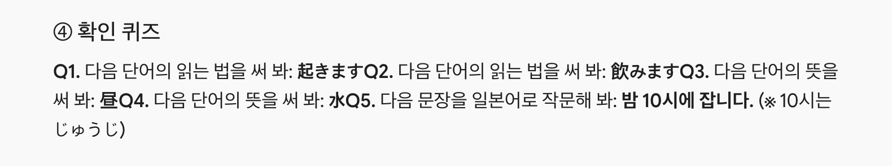

# LLM 모델 비교와 선정 보고서

## 과업

일본어 교양 수업에서 그날 배운 단어 목록과 문법 포인트를 받아 복습 학습지(단어장, 문법 설명, 예문, 퀴즈, 정답)를 만든다.
과업 정의와 프롬프트 전문은 [system-design.md](system-design.md)에 있다.

## 비교 대상 모델

| 모델 | 서비스 | 버전 표시 | 요금제 | 실행 시점 |
|---|---|---|---|---|
| Claude | claude.ai | Opus 5.5 | 유료 | 2026-11-21 16:55 |
| Gemini | gemini.google.com | Hydrogen (사고 수준: 낮음) | 유료 | 2026-11-21 16:58 |
| ChatGPT | chatgpt.com | GPT-6 | **무료** | 2026-11-21 16:58 |

- **무료 요금제로 사용할 수 있는 모델: ChatGPT GPT-6**
- 버전은 각 서비스의 모델 선택 화면에 보이는 이름을 그대로 적었다.

## 비교 방법

- 세 서비스 모두 새 채팅을 열고, 같은 메시지를 한 글자도 바꾸지 않고 넣었다.
- 넣은 메시지: 시스템 프롬프트 v1 (Few-shot 예시 없음) + 유저 프롬프트 + 제2과 하루 일과 자료 (단어 10개, 문법 2개)
- 각 모델의 결과 원문은 이 문서 아래 "부록: 모델별 결과 원문"에 실었다.

## 비교표

점수: 1~5 (클수록 좋음). 점수와 근거는 직접 매겼다.

| 비교 기준 | Claude Opus 5.5 (유료, 2026-11-21 16:55) | Gemini Hydrogen 사고 수준 낮음 (유료, 2026-11-21 16:58) | ChatGPT GPT-6 (무료, 2026-11-21 16:58) | 근거 |
|---|---|---|---|---|
| 형식 준수 | 5 | 4 | 5 | 셋 다 문법 2~3줄, 퀴즈 5문제 배분을 지킴. Gemini는 퀴즈 Q1~Q5가 따로 나뉘지 않고 한 줄로 이어져 보여서 보기 불편함 (화면 캡처로 확인) |
| 입력 자료와 일치 | 5 | 5 | 5 | 셋 다 단어 10개, 읽는 법, 뜻을 입력 그대로 씀 |
| 사실 정확도 | 5 | 5 | 5 | 단어 읽는 법과 퀴즈 정답에 틀린 것 없음 |
| 예문 자연스러움 | 5 | 4 | 4 | Gemini와 ChatGPT는 시간 뒤에 に 없이 "夜 ご飯を 食べます"처럼 써서 "저녁 밥을 먹습니다"가 어색하게 느껴짐. 「夜に ご飯を 食べます」가 더 자연스러운 것 같음. 「夜 10時に 寝ます」는 괜찮음. Claude만 예문이 자연스러움 |
| 페르소나 유지 | 5 | 3 | 4 | Claude만 "안녕, 나 하루야!"라고 역할을 밝히고 하루로서 말함. ChatGPT는 이름은 안 밝혔지만 반말과 격려로 역할을 지킴. Gemini는 역할 느낌이 가장 약함 |
| **합계** | **25** | **21** | **23** | |

형식 준수 감점 근거 (Gemini 화면, 퀴즈 Q1~Q5가 한 줄로 이어져 보임):



## 선정 결론

**선정: Claude Opus 5.5**

선정 이유 (직접 작성):
유료 Opus 모델답게 정리가 가장 깔끔했고, "나 하루야"처럼 부여한 역할을 진짜로 맡은 느낌이 들었다. 예문도 셋 중 제일 자연스러웠다. 퀴즈는 세 모델이 비슷했지만, 페르소나를 가장 잘 지켰다는 점에서 차이가 났다. 역할 준수는 ChatGPT, Gemini 순이었다. 유료인데도 고른 이유는, 사용자 프롬프트의 요구를 잘 따라 준다는 유료 모델의 장점이 결과에서 확실히 드러났기 때문이다.

---

## 부록: 모델별 결과 원문

복사한 그대로 실었다. ChatGPT 결과의 `\!`, `\~`처럼 역슬래시가 붙은 부분은 복사 과정에서 생긴 것이다.

<details>
<summary>Claude Opus 5.5 (2026-11-21 16:55)</summary>

```
# 📒 제2과 하루 일과 – 복습 학습지

안녕, 나 하루야! 오늘 배운 거 같이 정리해 보자 😊

## ① 단어장

| 단어 | 읽는 법 | 뜻 |
|---|---|---|
| 朝 | あさ | 아침 |
| 昼 | ひる | 점심, 낮 |
| 夜 | よる | 밤 |
| ご飯 | ごはん | 밥 |
| 水 | みず | 물 |
| 起きます | おきます | 일어납니다 |
| 寝ます | ねます | 잡니다 |
| 食べます | たべます | 먹습니다 |
| 飲みます | のみます | 마십니다 |
| 〜時 | 〜じ | ~시 |

## ② 오늘의 문법

- **〜ます / 〜ません**: 동사 끝을 「ます」로 쓰면 "~합니다", 「ません」으로 바꾸면 "~하지 않습니다"야. 예를 들어 食べます는 "먹습니다", 食べません은 "먹지 않습니다"가 돼.
- **시간 + に**: "몇 시에"라고 할 때는 숫자 시간 뒤에 「に」를 붙여. 6時に는 "6시에"라는 뜻이야.
- 💡 **팁**: 朝・昼・夜처럼 숫자가 없는 시간 말에는 보통 に를 안 붙여. 「朝に」가 아니라 「朝」만 써!

## ③ 예문

| 일본어 | 읽는 법 | 한국어 해석 |
|---|---|---|
| 朝 6時に 起きます。 | あさ ろくじに おきます。 | 아침 6시에 일어납니다. |
| 夜 10時に 寝ます。 | よる じゅうじに ねます。 | 밤 10시에 잡니다. |
| 夜は ご飯を 食べません。 | よるは ごはんを たべません。 | 밤에는 밥을 먹지 않습니다. |

※ 예문에 나온 は(~은/는), を(~을/를)는 문장을 만들려고 넣은 기본 조사야.

## ④ 확인 퀴즈

**[읽는 법]**
1. 「起きます」는 어떻게 읽을까?
2. 「夜」는 어떻게 읽을까?

**[뜻]**
3. 「飲みます」는 무슨 뜻일까?
4. 「昼」는 무슨 뜻일까?

**[작문]**
5. "물을 마시지 않습니다"를 일본어로 써 봐.

## ⑤ 퀴즈 정답

1. おきます
2. よる
3. 마십니다
4. 점심, 낮
5. 水を 飲みません。(みずを のみません。)

---

오늘 단어 10개에 문법 두 개나 끝냈네, 진짜 잘했어! 내일 아침에 일어나면 「朝 ○時に 起きます」라고 혼잣말 한 번 해 봐 🌅 がんばって!
```

</details>

<details>
<summary>Gemini Hydrogen, 사고 수준 낮음 (2026-11-21 16:58)</summary>

```
오늘 배운 **제2과 하루 일과** 복습 학습지야! 차근차근 정리해 봤으니 같이 복습해 보자.

### ① 단어장

| 단어 | 읽는 법 | 뜻 |
| --- | --- | --- |
| 朝 | あさ | 아침 |
| 昼 | ひる | 점심, 낮 |
| 夜 | よる | 밤 |
| ご飯 | ごはん | 밥 |
| 水 | みず | 물 |
| 起きます | おきます | 일어납니다 |
| 寝ます | ねます | 잡니다 |
| 食べます | たべます | 먹습니다 |
| 飲みます | のみます | 마십니다 |
| 〜時 | 〜じ | ~시 |

---

### ② 오늘의 문법

* **〜ます / 〜ません**: 동사 뒤에 붙여서 정중한 표현을 만들어. 긍정형은 **'~합니다(〜ます)'**, 부정형은 '~하지 않습니다(〜ません)'로 쓰면 돼.
* **시간 + に**: 동작이 일어나는 구체적인 시간 뒤에 조사 'に'를 붙여서 '~시에'라는 뜻으로 사용해. (단, '아침(朝)', '낮(昼)', '밤(夜)'처럼 구체적인 시각이 아닌 명사 뒤에는 보통 붙이지 않아!)

---

### ③ 예문

1. **朝 7時に 起きます。**
* 읽는 법: あさ しちじに おきます。 (※ 7시 읽는 법은 'ななじ' 또는 'しちじ' 확인 필요)
* 해석: 아침 7시에 일어납니다.


2. **昼 ご飯を 食べます。**
* 읽는 법: ひる ごはんを たべます。
* 해석: 점심 밥을 먹습니다.


3. **夜 水を 飲みません。**
* 읽는 법: よる みずを のみません。
* 해석: 밤에 물을 마시지 않습니다.


---

### ④ 확인 퀴즈

**Q1.** 다음 단어의 읽는 법을 써 봐: **起きます**
**Q2.** 다음 단어의 읽는 법을 써 봐: **飲みます**
**Q3.** 다음 단어의 뜻을 써 봐: **昼**
**Q4.** 다음 단어의 뜻을 써 봐: **水**
**Q5.** 다음 문장을 일본어로 작문해 봐: **밤 10시에 잡니다.** (※ 10시는 じゅうじ)

---

### ⑤ 퀴즈 정답

* **Q1.** おきます
* **Q2.** のみます
* **Q3.** 점심, 낮
* **Q4.** 물
* **Q5.** 夜 10時に 寝ます。 (よる じゅうじに ねます。)

---

오늘 분량도 정말 깔끔하게 잘 정리했네! 동사 기본 어휘들이라 앞으로 계속 쓰일 테니 입으로 소리 내어 읽으면서 꼭 외워 두자. 오늘도 고생 많았어, 화이팅!
```

</details>

<details>
<summary>ChatGPT GPT-6 (2026-11-21 16:58)</summary>

```
# 🌸 제2과 복습 학습지 — 하루 일과

오늘 배운 단어와 문법을 정리해 보자\! 😊

## ① 오늘의 단어장

| 단어 | 읽는 법 | 뜻 |
| --- | --- | --- |
| 朝 | あさ | 아침 |
| 昼 | ひる | 점심, 낮 |
| 夜 | よる | 밤 |
| ご飯 | ごはん | 밥 |
| 水 | みず | 물 |
| 起きます | おきます | 일어납니다 |
| 寝ます | ねます | 잡니다 |
| 食べます | たべます | 먹습니다 |
| 飲みます | のみます | 마십니다 |
| 〜時 | 〜じ | \~시 |

## ② 오늘의 문법

1. 〜ます (\~합니다)

동사의 정중한 긍정 표현이야.

- 食べます : 먹습니다
- 飲みます : 마십니다

2. 〜ません (\~하지 않습니다)

동사의 정중한 부정 표현이야.

- 食べません : 먹지 않습니다
- 飲みません : 마시지 않습니다

3. 시간 + に (\~시에)

어떤 행동을 하는 시간을 나타낼 때 사용해.

- 7時に起きます : 7시에 일어납니다.

## ③ 예문 3개

예문 1

- 일본어: 朝7時に起きます。
- 읽는 법: あさ しちじに おきます。
- 해석: 아침 7시에 일어납니다.

예문 2

- 일본어: 夜ご飯を食べます。
- 읽는 법: よる ごはんを たべます。
- 해석: 밤에 밥을 먹습니다.

예문 3

- 일본어: 昼に水を飲みません。
- 읽는 법: ひるに みずを のみません。
- 해석: 낮에 물을 마시지 않습니다.

## ④ 확인 퀴즈 5문항

직접 풀어 봐\! 정답은 아래에 있어. ✏️

### Q1. 읽는 법

朝의 읽는 법은?

### Q2. 읽는 법

飲みます의 읽는 법은?

### Q3. 뜻

寝ます의 뜻은?

### Q4. 뜻

〜ません의 뜻은?

### Q5. 작문

다음 문장을 일본어로 바꿔 봐.

"7시에 일어납니다."

## ⑤ 퀴즈 정답

정답 확인하기

1. あさ
2. のみます
3. 잡니다
4. \~하지 않습니다
5. 7時に起きます。

🌷 오늘 배운 내용은 단어와 문법을 함께 외우면 더 오래 기억할 수 있어\!

조금씩 반복하면 일본어 실력이 쑥쑥 늘 거야. 오늘도 수고했어\! 💛
```

</details>
